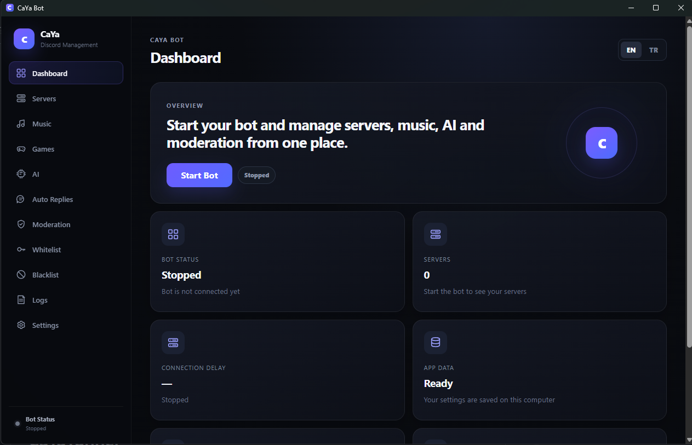

# CaYaDiscordBot-GUI

[English README](README.md)

CaYaDiscordBot-GUI, yapılandırma dosyalarını elle düzenlemeden bir Discord botunu çalıştırmak ve yönetmek için hazırlanmış Windows masaüstü kontrol merkezidir. Discord sunucu yönetimi, moderasyon, müzik, oyunlar, yerel yapay zeka, web araştırması ve görsel iş akışlarını tek bir Electron uygulamasında birleştirir.



## Öne çıkanlar

- Discord bot tokeninin işletim sisteminin korumalı depolama API'leriyle güvenli saklanması.
- Masaüstü arayüzünden sunucu görünümü, loglar ve çalışma durumu.
- Moderasyon araçları, beyaz/kara liste yönetimi, otomatik cevaplar ve link koruması.
- Yönetilen `yt-dlp`, paketlenmiş FFmpeg, kuyruk kontrolleri, gerçek Opus bitrate değişimi, metadata/stream cache ve ses kanalı güvenlik kontrolleriyle müzik sistemi.
- Taş-Kağıt-Makas, çok oyunculu Taş-Kağıt-Makas ve kura özelliklerini barındıran Oyunlar kategorisi.
- Normal sohbet, web araştırma yanıtı, görsel prompt düzenleme ve görsel analiz için bağımsız model seçimine sahip yerel Ollama entegrasyonu.
- Görsel ve GIF analizi için vision destekli Ollama modellerinin otomatik algılanması.
- Seçilebilir checkpoint ile isteğe bağlı ComfyUI görsel oluşturma.
- Birden fazla fallback sağlayıcısı ve kaynak gösterimi kullanan web araştırması.
- Sistem dilini otomatik algılayan ve manuel değiştirilebilen İngilizce/Türkçe arayüz.
- Yerel SQLite kalıcılığı. Kullanıcı verileri uygulama paketinin dışında tutulur.

## Gereksinimler

- Portable sürüm için Windows 10/11 x64.
- Discord Developer Portal üzerinden oluşturulmuş bir Discord bot uygulaması ve bot tokeni.
- Discord ve web araştırması özellikleri için internet bağlantısı.
- Yerel AI sohbeti / araştırma yanıtı / görsel analizi kullanacaksanız Ollama.
- Görsel oluşturma kullanacaksanız ComfyUI.

`yt-dlp` gerektiğinde uygulamanın yerel veri klasörüne otomatik indirilir. FFmpeg masaüstü uygulamasıyla birlikte paketlenir.

## Hızlı başlangıç

1. GitHub Releases bölümünden `CaYa-Bot-1.0.0-Portable.exe` dosyasını indirin.
2. Portable uygulamayı çalıştırın.
3. İlk açılışta uygulama veri klasörünü seçin.
4. **Ayarlar** bölümünden Discord bot tokeninizi kaydedin.
5. Kullanmak istediğiniz Ollama / ComfyUI ayarlarını yapılandırın.
6. Panelden botu başlatın.

## Discord izinleri ve intent'ler

Kullandığınız özelliklerin gerektirdiği intent'leri Discord Developer Portal üzerinden açın. Uygulama desteklediği bot özellikleri için guilds, guild messages, guild members, presences, voice states ve message content intent'lerini kullanır.

Botu sunucuya davet ederken yalnızca etkinleştirdiğiniz modüller için gerekli izinleri verin. Moderasyon işlemleri Discord tarafındaki ilgili izinleri gerektirir.

## Yapay zeka yapılandırması

Yeni kurulumda Yapay Zeka kategorisi varsayılan olarak kapalıdır. **Yapay Zeka** bölümünden açtıktan sonra şu katmanları birbirinden bağımsız ayarlayabilirsiniz:

- Sohbet yanıt modeli
- Web araştırma yanıt modeli
- Görsel prompt modeli
- Görsel analiz / vision modeli

Vision modeli seçiminde yalnızca yerel Ollama'nın vision yeteneği bildirdiği modeller listelenir. ComfyUI checkpoint seçimi Ollama model seçimlerinden bağımsızdır.

## Veri ve güvenlik

- Discord bot tokenleri proje kaynak kodunda veya repoda düz metin olarak tutulmaz.
- Kaydedilen bot tokenleri Electron `safeStorage` ile korunur ve kaydedildikten sonra renderer tarafına geri gönderilmez.
- SQLite veritabanları, loglar, environment dosyaları, yerel runtime araçları, build çıktıları ve release dosyaları Git tarafından yok sayılır.
- Renderer `contextIsolation` ile ve Node.js entegrasyonu kapalı şekilde, dar kapsamlı preload API üzerinden çalışır.

Bot tokeni, API anahtarı, kişisel veritabanı veya runtime verilerini hiçbir zaman repoya commit etmeyin. Bir Discord bot tokeni daha önce herkese açık şekilde sızdıysa tekrar kullanmadan önce Discord Developer Portal üzerinden yenileyin.

## Geliştirme

```bash
npm install
npm run typecheck
npm run build
npm run dev
```

Windows x64 portable build oluşturmak için:

```bash
npm run dist:win
```

Projede Electron, React, TypeScript, Vite, discord.js, SQLite, `@discordjs/voice`, `prism-media`, `ffmpeg-static` ve Sharp kullanılmaktadır.

## Ana modüller

- Panel
- Sunucular
- Müzik
- Oyunlar
- Yapay Zeka
- Otomatik Cevaplar
- Moderasyon
- Beyaz Liste
- Kara Liste
- Loglar
- Ayarlar

## Sürüm

Güncel sürüm: **1.0.0**

## Notlar

Bu proje yerel masaüstü uygulaması olarak tasarlanmıştır. Ollama ve ComfyUI entegrasyonları kullanıcının yapılandırdığı servislere, genellikle localhost üzerinden bağlanır. Kullanılabilirlik ve çıktı kalitesi kullanıcının bilgisayarında kurulu modellere ve servislere bağlıdır.
